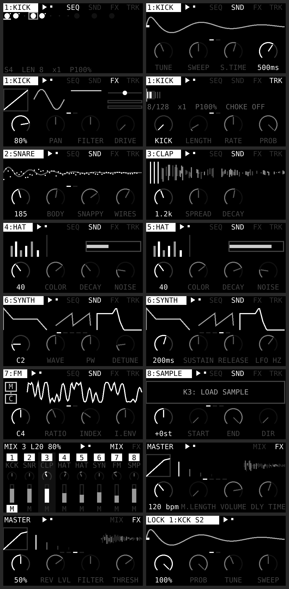

# loam

An 8-track groovebox for norns (shield or standard). Every drum sound is made from oscillators, noise, filters and envelopes. Each track can run any of ten engines, and grid support is optional.



## Install

Copy the `loam` folder from this repository to `~/dust/code/` on norns (lowercase `loam`, and only one copy), then restart norns (SYSTEM > RESTART) so SuperCollider compiles `Engine_Loam.sc`. Then pick loam from SELECT.

```bash
scp -r loam we@norns.local:~/dust/code/
```

## Engines (any track, any engine)

| Engine | How it's made |
|---|---|
| KICK | sine with exponential pitch sweep, noise click, tanh drive |
| SNARE | two triangles (1 : 1.84) with pitch drop + high-passed noise "wires" |
| CLAP | band-passed noise retriggered 3x, then a tail |
| HAT | six square oscillators at metallic ratios -> band-pass -> high-pass (open/closed = decay + choke group) |
| TOM | swept sine + low-passed skin noise |
| RIM | triangle + pulse click |
| COWBELL | two squares through a band-pass |
| SYNTH | 2 oscillators (sin/tri/saw/sqr/noise) + sub, LP/HP/BP/NOTCH filter with env, ADSR, LFO (sin/tri/saw/sqr/S&H -> pitch/cutoff/amp/pan) |
| FM | 2-op FM, modulator feedback, index envelope |
| SAMPLE | any file from `~/dust/audio` (incl. `audio/common`), start/end, pitch, reverse, one-shot or gated, filter, attack/release, normalize on load |

Every track has its own insert effects: level, pan, DJ filter, drive, bit depth, sample-rate reduction, and sends to the delay and reverb. The master bus has a tempo-synced ping-pong delay, reverb, a DJ filter, a compressor (threshold, ratio, attack, release, makeup gain), a limiter and volume.

## Live parameter changes

Turning a knob changes sounds that are already ringing, not just the next hit. That includes the drum decays, pitch, filters, drive, the synth's sustain and LFO, the sample's pitch and END point, and all track and master effects.

A few settings only apply at the start of a hit: where a sample starts, attack times, the gap between clap hits, velocity, and the FILTER type on SYNTH and SAMPLE tracks. CUTOFF and RES stay live. Each voice only runs the one filter it needs, which keeps CPU use down.

Each track plays at most 6 voices at once. When a 7th starts, the oldest is cut. This keeps long samples or long releases on fast patterns from overloading the norns, which would otherwise come out as clicks and pops.

## Samples and zero crossings

Sample hits open at the first zero crossing of the waveform, so playback never starts mid-wave. They also close at a zero crossing when they reach END, get choked, or are cut by the voice limit. A sound that never crosses zero, such as one with a DC offset, is cut after 30 ms anyway. Your ATTACK and RELEASE knobs work on top of that: RELEASE gives a tail in GATE mode, and a fade that finishes at END in ONESHOT mode.

## Normalize

With NORMALIZE on (SND tab, on by default), each sample is scaled as it loads so its loudest point sits at −3 dB. Quiet files come up to the same level as loud ones, and there's headroom left for overlapping hits and resonant filters. Samples are held and processed as 32-bit floating point, so normalizing is a plain multiplication that never clips or quantizes anything. Switch it off to keep a file's original level. Switching it reloads the track's sample straight away.

## Master compressor

The master compressor follows a 20 ms average (RMS) of the level, not the raw waveform, so it never changes gain within a single bass cycle. That keeps kicks, 808s and bass clean instead of gritty.

## CPU

Effects only run while they're in use, to leave the norns as much headroom as possible:

- A track's DRIVE / BITS / S.RATE / FILTER section only exists while one of those knobs is away from neutral.
- The delay and reverb run only while some track sends to them. They keep running for 12 seconds after the last send closes, so tails ring out.

If you still hear crackles on busy patterns, use choke MONO on tracks with long samples, shorten long releases, and turn unused sends fully down.

Parameter locks still belong to their step. A locked step plays with its locked values and keeps them while it rings. Turning a knob afterwards does move the ringing locked note too, since that's the knob you're turning.

## LFOs

Every track has 4 LFOs on its own **LFO** tab (after TRK). Each LFO has two knob pages:

| Knob | |
|---|---|
| DEST | what it moves: any sound parameter of the track's engine, the track's FX (level, pan, filter, drive, bits, sample rate, delay and reverb sends), or the sequencer's PROB and GATE. DEST only offers what exists on the current engine. |
| MODE | **FREE** runs on its own at RATE (Hz). **RETRIG** restarts every time the track plays a step. **SYNC** locks to the master tempo. |
| RATE | Hz in FREE and RETRIG mode, or a note length per cycle in SYNC mode: 1/32 to 16 bars, including triplet (T) and dotted (D) values |
| DEPTH | how far it moves the parameter. 100% sweeps the whole knob range; negative values invert the movement |
| SHAPE | sine, triangle, ramp up, ramp down, square, sample & hold, drift (smooth random). Sine, triangle and ramps start their cycle at 0 (the knob's own value) and square at its high half. S&H and drift pick a new value every cycle, and on every hit in RETRIG mode; drift glides to it in at most 1 second |
| PHASE | where in its cycle it starts |

- Modulation is applied around the knob's current value, on the knob's own scale, so a filter LFO sweeps in octaves rather than in Hz. The knob still sets the center.
- Sound and FX destinations run in the sound engine. They move continuously and also affect notes that are already ringing.
- PROB and GATE are applied by the sequencer at each step.
- The DEST knob spreads only the destinations available on the track's current engine evenly around its turn, with OFF at the bottom.
- Several LFOs on one parameter add together.
- A locked step keeps its locked value, so the LFO doesn't move that parameter on that step.
- Knobs being modulated show a small **~** mark on the SND, FX and TRK tabs.
- The LFO tab shows the selected LFO's cycle with a moving dot, where it's routed, and live meters for all four.
- Choose FILTER type, sample NORMALIZE and the synth's FILTER type at the hit or at load, not with an LFO, so they aren't LFO destinations.
- A track's LFOs only use CPU while at least one of them is routed to a sound or FX parameter.

## Sequencer

- Each track has 128 steps, its own length (1–128) and its own rate, from 1/8x up to 8x, including triplet rates (1/3, 2/3, 4/3, 3/2, x3, x6).
- **Probability** can be set per track, and overridden per step with a lock.
- **Parameter locks**: any engine parameter, plus velocity and probability, can be locked on any step.
- **Master length** (MASTER > FX > M.LENGTH, counted in 16ths) sends every track back to step 1 each time that count is reached. 0 turns it off.
- **Choke**: MONO cuts the track's own previous note. Tracks set to the same group A–D cut each other, for example a closed hat cutting an open hat.

## Controls

| | |
|---|---|
| E1 | page: MASTER, track 1–8 (also picks the track shown on grid) |
| K2 | next tab (track: SEQ / SND / FX / TRK / LFO, master: MIX / FX) |
| K1+K2 | play / stop |
| K1 (hold) | shift: fine adjust |
| E2 / E3 | select knob / change value |

**SEQ tab:** E2 moves the cursor and E3 jumps a row. K3 toggles the step. K1+E2 changes the length. K1+E3 sets the step's velocity. K1+K3 opens lock mode for the cursor step.
**Lock mode:** E2 selects a parameter and E3 sets the locked value. K3 clears that lock and K2 exits.
**SND tab:** K3 auditions the track. On a SAMPLE track, K3 opens the file browser and K1+K3 auditions.
**MASTER > MIX:** E2 selects a track, E3 pans it, K1+E3 sets its level, and K3 mutes it.
**MASTER > FX:** K3 sends every track back to step 1.

**Clearing:** on a track's **TRK** tab, K1+K3 clears that track. On either **MASTER** tab, K1+K3 clears all 8 tracks. A box asks you to confirm: K3 = yes, K2 = no. Clearing removes the steps and their locks. It keeps the track's sound, length, rate and effects.

### Grid (16x8)

The grid shows the selected track's 128 steps (row 1 = steps 1–16 … row 8 = 113–128).
- Tap a step to toggle it.
- Hold step 1 and press another step to make that step the loop end.
- Hold a step and turn E2/E3 to lock parameters on that step (an empty step becomes a trig).

LEDs: dim = inside the loop, mid = trig, bright = trig with locks, full = playhead.

## Saving

The script always opens with an empty pattern. Sounds, effects and mixer settings from your last session come back automatically.

To keep a pattern, save a PSET (PARAMETERS > PSET > SAVE). That stores the steps and locks with it (`dust/data/loam/pattern-N.data`), and loading the PSET brings them back.

## No sound? MASTER > DIAG

Turn E1 all the way left to MASTER, then press K2 until **DIAG** is lit. The page shows:

- **ENGINE**: whether Loam's sound engine loaded.
- **ENGINE COPIES**: how many `Engine_Loam.sc` files are installed under `dust/code`. Two copies, e.g. an old copy in another folder, make SuperCollider refuse to start, and every script goes silent. Keep one, delete the rest, then SYSTEM > RESTART. Loam also warns about this on screen when it starts.
- **HITS RECEIVED**: how many hits the sound engine has received from the sequencer (or from K3 auditions).
- **OUT**: the engine's live output level.
- **ENGINE ERRORS**: anything that failed while the sound engine loaded. The engine keeps loading past a failure, so the script still starts and the error text appears on screen. K1+K3 shows it again.
- **K3: TEST TONE**: a short 440 Hz beep sent straight to the norns output, past every track and effect.

If the test tone is silent too, check the norns LEVELS menu (the engine fader) and the output level.

